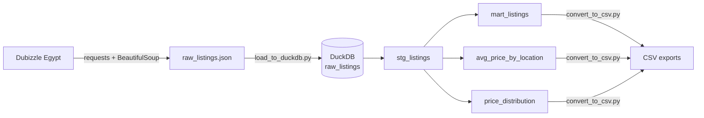

# Egypt Real Estate Pipeline

An end-to-end data engineering pipeline that scrapes apartment-for-sale listings
from **Dubizzle Egypt**, loads them into **DuckDB**, models them with **dbt**, and
runs daily on **Apache Airflow** inside **Docker**. The output is a small set of
analytics tables on Cairo property prices: price per square meter, price buckets
and average price by area.

## Architecture



The Airflow DAG `egypt_realestate_pipeline` runs every day at 08:00:

```
scrape_listings → load_to_duckdb → dbt_run → dbt_test → convert_to_csv
```

Each task fails loudly, so a broken step stops the run instead of passing
empty data downstream. Every task retries once after 5 minutes.

## Tech stack

| Layer            | Tool                        | Role                                        |
|------------------|-----------------------------|---------------------------------------------|
| Ingestion        | Python, requests, BeautifulSoup | Scrape listing pages and parse each ad  |
| Storage          | DuckDB                      | Embedded analytical database                |
| Transformation   | dbt Core 1.7 + dbt-duckdb   | Staging and mart models, data tests         |
| Orchestration    | Apache Airflow 2.9          | Daily schedule, retries, task dependencies  |
| Packaging        | Docker Compose              | One-command local Airflow setup             |

## Data models

| Model                   | Layer   | Type  | Description |
|-------------------------|---------|-------|-------------|
| `stg_listings`          | staging | view  | Parses the raw price and area strings into numbers, computes EGP per sqm and drops implausible bedroom counts |
| `mart_listings`         | mart    | table | One row per listing, with a `price_bucket` (`under_3m`, `3m_to_5m`, `5m_to_10m`, `10m_plus`) |
| `avg_price_by_location` | mart    | table | Listing count and average, min and max price per location |
| `price_distribution`    | mart    | table | Listing count and average price per price bucket |

### Data quality tests

`dbt test` runs **15 tests**:

- `not_null` on the key fields: title, URL, raw and parsed price, area and timestamp
- `unique` on the aggregation keys (`location`, `price_bucket`)
- `accepted_values` on `price_bucket` in both mart tables

## Project structure

```
egypt-realestate-pipeline/
├── dags/
│   └── realestate_pipeline.py      # Airflow DAG (5 tasks)
├── scraper/
│   ├── dubizzle_scraper.py         # Scrapes listings → data/raw_listings.json
│   └── load_to_duckdb.py           # Loads the JSON into DuckDB
├── conversion/
│   └── convert_to_csv.py           # Exports the mart tables to CSV
├── dbt_project/
│   ├── models/
│   │   ├── staging/                # stg_listings + sources and tests (schema.yml)
│   │   └── marts/                  # mart_listings, avg_price_by_location, price_distribution
│   ├── dbt_project.yml
│   └── profiles.yml                # DuckDB path from DUCKDB_PATH (default ../data)
├── data/                           # Raw JSON + CSV outputs (the .duckdb file is git-ignored)
├── docker-compose.yml
└── requirements.txt
```

## Getting started

```bash
git clone https://github.com/GigiMW/egypt-realestate-pipeline.git
cd egypt-realestate-pipeline/egypt-realestate-pipeline
```

### Option 1: Docker + Airflow (recommended)

Requires [Docker Desktop](https://www.docker.com/products/docker-desktop/).

```bash
docker compose up
```

The first start takes a few minutes while the container installs dbt and
DuckDB. Then:

1. Open <http://localhost:8080> and sign in with `admin` / `admin`.
2. Unpause the **`egypt_realestate_pipeline`** DAG and click **Trigger DAG**.
3. When all five tasks are green, the fresh CSVs are in `data/`.

Stop everything with `docker compose down`.

### Option 2: Run the steps manually

Requires **Python 3.11 or 3.12** (dbt 1.7 does not support 3.13).

```bash
python -m venv venv
source venv/bin/activate          # Windows: venv\Scripts\activate
pip install -r requirements.txt
```

```bash
python scraper/dubizzle_scraper.py       # 1. scrape → data/raw_listings.json
python scraper/load_to_duckdb.py         # 2. load → data/realestate.duckdb

cd dbt_project
dbt run  --profiles-dir .                # 3. build the 4 models
dbt test --profiles-dir .                # 4. run the 15 tests
cd ..

python conversion/convert_to_csv.py      # 5. export marts → data/*.csv
```

To explore the models and the lineage graph:

```bash
cd dbt_project
dbt docs generate --profiles-dir . && dbt docs serve --profiles-dir . --port 8081
```

## Sample output

From the snapshot in `data/` (18 listings, mostly New Cairo):

| Price bucket | Listings | Avg price (EGP) | Avg EGP / sqm |
|--------------|---------:|----------------:|--------------:|
| 10M+         | 9        | 14,277,111      | 81,450        |
| 5M – 10M     | 8        | 6,652,125       | 40,650        |
| 3M – 5M      | 1        | 4,700,000       | 42,727        |

## Configuration

| Setting      | Where                            | Default |
|--------------|----------------------------------|---------|
| `DUCKDB_PATH`| environment variable             | `data/realestate.duckdb` (`/opt/airflow/data/...` in Docker) |
| Pages scraped| `MAX_PAGES` in `dubizzle_scraper.py` | 3 |
| Ads per page | `ADS_PER_PAGE` in `dubizzle_scraper.py` | 12 |
| Schedule     | `schedule_interval` in the DAG   | `0 8 * * *` (daily, 08:00) |

## Limitations and next steps

- **The scraper depends on Dubizzle's HTML.** If the site changes its layout or
  blocks the request, the scrape task fails and the run stops.
- **Locations are free text.** They are parsed from each ad's text, so the same area
  can appear under different spellings. Mapping them to a fixed list of
  districts would make `avg_price_by_location` more reliable.
- **Each run replaces the previous data.** Keeping a dated history would allow
  price trends over time, for example with an incremental model or a dbt snapshot.
- **Docker installs packages on every start.** The Compose file uses
  `_PIP_ADDITIONAL_REQUIREMENTS`, which is fine locally. A production setup would
  build a custom image with the packages already installed.

## Disclaimer

This is a portfolio and learning project. Listing data belongs to Dubizzle and its
advertisers. Scrape responsibly and respect the site's terms of use.
