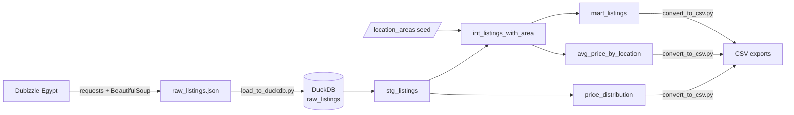

# Egypt Real Estate Pipeline

[](https://github.com/GigiMW/egypt-realestate-pipeline/actions/workflows/ci.yml)

An end-to-end data engineering pipeline that scrapes apartment-for-sale listings
from **Dubizzle Egypt**, loads them into **DuckDB**, models them with **dbt**, and
runs daily on **Apache Airflow** inside **Docker**. The output is a small set of
analytics tables on Cairo property prices: price per square meter, price buckets
and average price by area.

## Architecture



The Airflow DAG `egypt_realestate_pipeline` runs every day at 08:00:

```
scrape_listings → load_to_duckdb → dbt_run → dbt_test → convert_to_csv
```

Each task fails loudly, so a broken step stops the run instead of passing
empty data downstream. Every task retries once after 5 minutes.

## Tech stack

| Layer            | Tool                        | Role                                        |
|------------------|-----------------------------|---------------------------------------------|
| Ingestion        | Python, requests, BeautifulSoup | Scrape listing pages and parse each ad  |
| Storage          | DuckDB                      | Embedded analytical database                |
| Transformation   | dbt Core 1.7 + dbt-duckdb   | Staging and mart models, data tests         |
| Orchestration    | Apache Airflow 2.9          | Daily schedule, retries, task dependencies  |
| Packaging        | Docker Compose              | One-command local Airflow setup             |

## Data models

| Model                   | Layer   | Type  | Description |
|-------------------------|---------|-------|-------------|
| `stg_listings`          | staging | view  | Parses the raw price and area strings into numbers, computes EGP per sqm and drops implausible bedroom counts |
| `int_listings_with_area`| intermediate | view | Maps each listing to a clean `area` (New Cairo, 6th of October, New Capital…) using the `location_areas` seed |
| `mart_listings`         | mart    | table | One row per listing with its `area` and a `price_bucket` (`under_3m`, `3m_to_5m`, `5m_to_10m`, `10m_plus`) |
| `avg_price_by_location` | mart    | table | Listing count, average and median price per sqm, and min/max price per area |
| `price_distribution`    | mart    | table | Listing count and average price per price bucket |

### Data quality tests

`dbt test` runs **23 tests**:

- `not_null` on the key fields: title, URL, raw and parsed price, area and timestamp
- `unique` on listing URLs, so the same ad can't be counted twice
- `unique` on the aggregation keys (`area`, `price_bucket`)
- `accepted_values` on `price_bucket` in both mart tables
- `not_null` and `unique` on the seed's keywords

### How areas are cleaned

Ads don't have a structured location field, so the scraped `location` is often
noise ("the", "very", "Ready Duplex"). Instead, `int_listings_with_area` searches the
**title and location** for keywords from
[`seeds/location_areas.csv`](egypt-realestate-pipeline/dbt_project/seeds/location_areas.csv).
The keywords cover areas, compounds and landmarks, for example `fifth settlement`,
`taj city`, `r7` and `mall of egypt`. When several keywords match, the **longest
one wins**, so `mountain view icity october` (6th of October) beats
`mountain view`. Listings with no match are labeled `Unknown`.

To support a new area or compound, add a row to the CSV. No SQL changes are needed.

## Project structure

```
egypt-realestate-pipeline/
├── dags/
│   └── realestate_pipeline.py      # Airflow DAG (5 tasks)
├── scraper/
│   ├── dubizzle_scraper.py         # Scrapes listings → data/raw_listings.json
│   └── load_to_duckdb.py           # Loads the JSON into DuckDB
├── conversion/
│   └── convert_to_csv.py           # Exports the mart tables to CSV
├── dbt_project/
│   ├── models/
│   │   ├── staging/                # stg_listings + sources and tests (schema.yml)
│   │   ├── intermediate/           # int_listings_with_area (area mapping)
│   │   └── marts/                  # mart_listings, avg_price_by_location, price_distribution
│   ├── seeds/
│   │   └── location_areas.csv      # keyword → area lookup
│   ├── dbt_project.yml
│   └── profiles.yml                # DuckDB path from DUCKDB_PATH (default ../data)
├── data/                           # Raw JSON + CSV outputs (the .duckdb file is git-ignored)
├── docker-compose.yml              # Reads secrets from .env
├── .github/workflows/ci.yml        # (repo root) CI: full pipeline on every push
├── .env.example                    # Template for your local .env (never commit .env)
└── requirements.txt
```

## Getting started

```bash
git clone https://github.com/GigiMW/egypt-realestate-pipeline.git
cd egypt-realestate-pipeline/egypt-realestate-pipeline
```

### Option 1: Docker + Airflow (recommended)

Requires [Docker Desktop](https://www.docker.com/products/docker-desktop/).

**1. Create your `.env` file.** It holds your Airflow keys and admin password.
Git ignores it, so it is never committed.

```bash
cp .env.example .env              # Windows: copy .env.example .env
```

Open `.env` and fill in the values. The two keys can be generated with:

```bash
python -c "from cryptography.fernet import Fernet; print(Fernet.generate_key().decode())"
python -c "import secrets; print(secrets.token_hex(32))"
```

(The first command needs `pip install cryptography`.) Docker Compose refuses
to start until all the required values are set.

**2. Start Airflow:**

```bash
docker compose up
```

The first start takes a few minutes while the container installs dbt and
DuckDB. Then:

1. Open <http://localhost:8080> and sign in with the username and password from your `.env`.
2. Unpause the **`egypt_realestate_pipeline`** DAG and click **Trigger DAG**.
3. When all five tasks are green, the fresh CSVs are in `data/`.

Stop everything with `docker compose down`.

### Option 2: Run the steps manually

Requires **Python 3.11 or 3.12** (dbt 1.7 does not support 3.13).

```bash
python -m venv venv
source venv/bin/activate          # Windows: venv\Scripts\activate
pip install -r requirements.txt
```

```bash
python scraper/dubizzle_scraper.py       # 1. scrape → data/raw_listings.json
python scraper/load_to_duckdb.py         # 2. load → data/realestate.duckdb

cd dbt_project
dbt build --profiles-dir .               # 3. load the seed, build 5 models, run 23 tests
cd ..

python conversion/convert_to_csv.py      # 5. export marts → data/*.csv
```

To explore the models and the lineage graph:

```bash
cd dbt_project
dbt docs generate --profiles-dir . && dbt docs serve --profiles-dir . --port 8081
```

## Sample output

From the snapshot in `data/` (18 listings, mostly New Cairo):

| Price bucket | Listings | Avg price (EGP) | Avg EGP / sqm |
|--------------|---------:|----------------:|--------------:|
| 10M+         | 9        | 14,277,111      | 81,450        |
| 5M – 10M     | 8        | 6,652,125       | 40,650        |
| 3M – 5M      | 1        | 4,700,000       | 42,727        |

| Area           | Listings | Avg EGP / sqm | Median EGP / sqm |
|----------------|---------:|--------------:|-----------------:|
| New Cairo      | 10       | 71,168        | 73,316           |
| 6th of October | 3        | 36,575        | 34,595           |
| New Giza       | 1        | 91,837        | 91,837           |
| Suez           | 1        | 61,111        | 61,111           |
| El Rehab       | 1        | 54,000        | 54,000           |
| Mostakbal City | 1        | 42,727        | 42,727           |
| New Capital    | 1        | 29,900        | 29,900           |

With 18 listings these numbers are illustrative only. Most areas have a single ad.

## Continuous integration

[`.github/workflows/ci.yml`](.github/workflows/ci.yml) runs on every push and pull
request:

1. Installs the pinned dependencies on Python 3.12
2. Checks that all Python files compile
3. Loads the committed `data/raw_listings.json` into DuckDB (CI doesn't scrape
   live, so builds don't depend on Dubizzle)
4. Runs `dbt build`: the seed, all 5 models and all 23 tests
5. Exports the CSVs
6. Validates `docker-compose.yml`

## Configuration

| Setting      | Where                            | Default |
|--------------|----------------------------------|---------|
| `DUCKDB_PATH`| environment variable             | `data/realestate.duckdb` (`/opt/airflow/data/...` in Docker) |
| Pages scraped| `MAX_PAGES` in `dubizzle_scraper.py` | 3 |
| Ads per page | `ADS_PER_PAGE` in `dubizzle_scraper.py` | 12 |
| Schedule     | `schedule_interval` in the DAG   | `0 8 * * *` (daily, 08:00) |
| Airflow keys and login | `.env` (see `.env.example`) | none: required |

## Limitations and next steps

- **The scraper depends on Dubizzle's HTML.** If the site changes its layout or
  blocks the request, the scrape task fails and the run stops.
- **Area mapping is keyword-based.** Ads that name a compound missing from the
  seed end up as `Unknown`. Add the compound to `location_areas.csv` to fix them.
- **The sample is small.** The scraper reads 3 pages (about 36 ads). Raising
  `MAX_PAGES` gives more reliable averages.
- **Each run replaces the previous data.** Keeping a dated history would allow
  price trends over time, for example with an incremental model or a dbt snapshot.
- **Docker installs packages on every start.** The Compose file uses
  `_PIP_ADDITIONAL_REQUIREMENTS`, which is fine locally. A production setup would
  build a custom image with the packages already installed.

## Disclaimer

This is a portfolio and learning project. Listing data belongs to Dubizzle and its
advertisers. Scrape responsibly and respect the site's terms of use.
